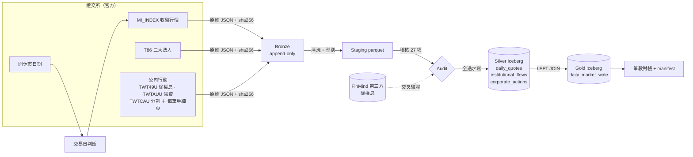
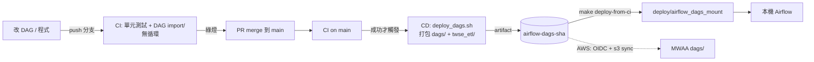

# TWSE Lakehouse ETL

每個交易日收盤後，自動抓證交所「每日收盤行情（MI_INDEX）」與「三大法人買賣超（T86）」，清洗成 parquet，
寫入 Iceberg，產出「每日個股行情＋法人買賣超」合併表，並能回答「上週算訊號時用的是哪一版資料」。

Airflow 3.3（docker-compose, LocalExecutor）· PyIceberg 0.12（SQLite catalog）· Polars · GitHub Actions
· 選配：S3（SeaweedFS）+ Postgres catalog + Trino





---

## 1. 啟動

前置（只裝這兩樣，其餘都在專案資料夾或容器內）：

```bash
brew install colima docker docker-compose && colima start --cpu 4 --memory 8
brew install uv                       # 有 Python 3.12 就用；沒有時 uv 自動下載到 .local/python/
```

```bash
make setup      # .venv（測試、本機跑 pipeline 用）
make up         # 產生 .env（本機隨機 secret）→ 部署 DAG → build image → 起 Airflow
make passwords  # 本機登入帳號：admin（管理）、trader（審核），密碼首次啟動時隨機產生
open http://localhost:8080
```

所有狀態都在 `.local/`（Iceberg warehouse、Bronze、log、uv cache），`make clean` 一次清掉；
Airflow metadata DB 在 Colima VM 內的 docker volume。

| 變數（`.env`） | 預設 | 用途 |
|---|---|---|
| `TWSE_SOURCE` | `twse` | `twse` 打真實 API；`fixture` 讀 `fixtures/` 錄好的原始回應（離線 / 被限流時） |
| `ANTHROPIC_API_KEY` | 無 | 啟用「臨時休市」LLM 查證；沒有就一律當異常告警（fail closed） |

## 2. 手動觸發 DAG

```bash
make trigger DATE=2026-10-29     # = airflow dags trigger twse_daily_etl --conf '{"trade_date": "2026-10-29"}'
make status                      # 各次 run 的狀態
```

UI 上按 Trigger 也可以，在 config 填 `trade_date`；留空就是排程當天。
排程：`30 15 * * 1-5`（Asia/Taipei），`catchup=False`、`max_active_runs=1`。

```
check_trading_day ─> wait_for_reports ─> route ─┬─> extract_{quotes,institutional,corporate_actions}
                                                │     ─> stage_* ─> audit ─> publish_silver ─> build_gold ─> reconcile
                                                │     ─> request_review ─> open_review（來源對不上才開審核單）
                                                └─> check_unscheduled_closure
```

| 情況 | 行為 |
|---|---|
| 週末、官方休市日 | `check_trading_day` short-circuit，整個 run 綠燈、下游 skipped |
| 資料晚發布 | sensor 每 10 分鐘看一次（`mode=reschedule` 不佔 worker），17:00 起每次告警 |
| 19:00 兩份都沒資料 | 問 LLM 是否臨時休市：有來源佐證 → 略過並記錄待人工確認；其他一律失敗＋告警 |
| 19:00 只出了一份（例如行情有、法人沒有） | 市場有開，只是晚了：不問 LLM，直接失敗＋告警，資料到了再重跑 |
| 前一個交易日沒載入 | 稽核擋下並指名要先補哪一天，不會誤報成「價格不連續」 |
| 網路 / TWSE 暫時錯誤 | extract 重試 3 次（指數退避），用盡才告警 |
| 稽核失敗、欄位改名（寫入前） | 不重試，直接失敗＋告警；Iceberg 完全沒動 |
| 對帳失敗（寫入後） | 失敗＋告警；資料已寫入，用 `make demo-rollback` 一次退回該 run 寫過的所有表 |
| 公司行動的來源對不上 | 當天照 TWSE 數字入庫、run 綠燈；每筆沒審過的事件開一張審核單給交易員（第 6 節） |

告警目前是 `ALERT <event> {json}` 的 log 行（`twse_etl/alerts.py`，換成 Slack/SNS 只改這一個函式）。

## 3. 版本控制示範（Iceberg）

在 Airflow 容器內執行，讀的是 DAG 寫的同一個 catalog：

| | 指令 | 示範什麼 |
|---|---|---|
| 必做 1 | `make demo-snapshots TABLE=daily_quotes` | snapshot 清單：id、時間、operation、run_id、新增/刪除筆數 |
| 必做 2 | `make demo-asof SNAPSHOT=<id>` 或 `make demo-asof AT='2026-10-30 19:29'` | time travel：給 snapshot id 或時間點，查當時內容 |
| 必做 3 | `make demo-correct DATE=2026-10-29` | 模擬證交所修正 2330 成交股數後重抓：無重複、新舊兩版都查得到 |
| 選做 1 | `make demo-rollback` | 退回最近一次 run 之前：該 run 寫過的每張表一起退（`TABLE=…` 只退一張） |
| 選做 2 | `make demo-evolve TABLE=daily_quotes` | 中途加欄位，舊資料與舊 snapshot 照樣可查 |
| 加做 | `make demo-adjusted STOCK=2762 START=2026-10-28 END=2026-10-30` | 還原權值（前復權；`METHOD=forward` 後復權），查詢時計算、不改歷史（第 6 節） |

`demo-correct` 實際輸出（節錄）：

```
simulated TWSE correction: 2026-10-29 2330 成交股數 18,403,916 -> 12,345,678
  daily_quotes         new snapshot 1729039165247099125
  institutional_flows  skipped (identical content)     <- 內容沒變就不產生 snapshot
  corporate_actions    skipped (identical content)
  daily_market_wide    new snapshot 1902940312798802552
rows for 2026-10-29: 1388, distinct stock_id: 1388  (no duplicates)
before snapshot 4941770685423036353: volume_shares=18,403,916
after  snapshot 1729039165247099125: volume_shares=12,345,678
```

一次「覆寫某一天」在 PyIceberg 是 **delete + append 兩個 snapshot、同一個 metadata commit**，
所以讀 current table 的人永遠看不到半套資料；snapshot 清單裡兩筆都帶同一個 run_id。

### 用 SQL 查：big-data 配置（S3 + Postgres catalog + Trino）

預設配置（SQLite catalog + 本機檔案）只能用 Python 讀。要讓策略團隊下 SQL，或資料量變大時：

```bash
make bigdata-up      # 疊加 docker-compose.bigdata.yaml：SeaweedFS（S3 API）+ Postgres（Iceberg JDBC catalog）+ Trino :8081
make trigger DATE=2026-10-29
make trino-sql SQL='SELECT trade_date, count(*) FROM iceberg.twse.daily_market_wide GROUP BY 1'
make trino-sql SQL='SELECT snapshot_id, operation, summary FROM iceberg.twse."daily_quotes$snapshots"'
make trino-sql SQL='SELECT count(*) FROM iceberg.twse.daily_quotes FOR VERSION AS OF <snapshot_id>'
make bigdata-down
```

- pipeline 程式沒有分支：只有 `ICEBERG_CATALOG_URI`、`ICEBERG_WAREHOUSE=s3://warehouse`、`PYICEBERG_CATALOG__TWSE__S3__*`
  這些環境變數不同。PyIceberg 寫、Trino 讀同一個 catalog、同一個 bucket；`make demo-*` 也照用。
- 實測（2026-10-30）：live 跑 10-28、10-29 後，Trino 查 Gold 得 1,386 / 1,388 筆；`$snapshots` 兩個 append；
  `FOR VERSION AS OF` 10-28 的 snapshot 回 1,386 筆，目前版本 2,774 筆。
- 這套的資料在 `.local/object-store/`，和預設配置的 `.local/lake/` 是分開的兩個資料湖。
  Bronze / staging 仍寫本機（`TWSE_DATA_URI`），上雲時同樣改成 `s3://`。
- 本機 S3 的 key `local-dev` 只在這幾個容器之間有效（object store 不對外開 port），不是真的憑證。
- UI：DBeaver（免費桌面版，內建 Trino driver）連 `localhost:8081`，使用者名稱隨意、免密碼，可下 SQL、瀏覽、匯出 CSV / Excel。
  要給團隊用網頁時再加 Superset 或 Metabase 一個服務。量再大時 Trino 加 worker；Spark 也能接同一個 JDBC catalog。

## 4. 測試

```bash
make test       # 73 個，不連網，約 5 秒
make dag-test   # 在正式 Airflow image 內：DagBag 無 import error、無循環、task 順序符合規格
make lint
```

測試資料是 `fixtures/` 裡錄好的真實 TWSE 回應，再加上刻意弄壞的版本：

| 測什麼 | 怎麼測 |
|---|---|
| 每一項阻擋檢查都真的會擋 | 真實的 10-29 先全過；再逐一注入 25 種壞資料（重複列、high 比 close 低、空值、符號錯、法人加總錯、800 筆半套…），每種都要讓對應的檢查失敗 |
| 等待閘門 | 空回應、TWSE 還在回前一天、上傳到一半（500 筆）都不能當成「資料到了」 |
| 臨時休市 | LLM 說沒休市、沒給來源、輸出不是 JSON、LLM 掛掉 → 都必須失敗；行情已出但法人沒出 → 連 LLM 都不問 |
| 冪等與修正 | 重跑不產生 snapshot；修正某天後無重複、舊版可查；修好 parser 後重跑會寫新版 |
| 還原權值 | 98 筆真實公司行動事件的官方參考價都能從明細頁重算；明細或參考價被改壞會被抓到；0050 分割日的連續性與還原後報酬 |
| 人工審核 | 對不上的事件只開一次單；覆寫值進新版本、舊版可查；沒理由、因子超範圍等不合法回答整批不寫 |
| 端到端 | 10-22 到 10-29 回填：颱風日、週末、補假、颱風日的除息在 10-27 生效、減資恢復交易 |

CI（`.github/workflows/ci.yml`）每次 push 跑這兩個 job；CD（`cd.yml`）只在 main 上 CI 成功後觸發。

**CI / CD 證據**：見下方 [第 9 節](#9-cicd-證據)。

## 5. 設計決策

### DAG
- **task 切法**：一個 task 做一件可以單獨重跑的事，task 之間只傳小東西（URI、snapshot id）。
  `publish_silver` 刻意一個 task 寫三張表，因為 SQLite catalog 同時只能有一個 writer。
- **交易日三道關**：cron 只排週一到五 → 官方開休市表 → 資料等待＋LLM 查證。
  第三道是因為颱風假永遠不會出現在官方表上（見第 6 節）。
- **重試只給會好的錯**：網路錯誤重試；資料錯誤（稽核失敗、欄位改名）重試也不會變好，直接失敗告警。

### Iceberg 而不是只放 parquet
- parquet 資料夾回答不了「上週二早上這張表長什麼樣」；Iceberg 每次寫入是一個 snapshot，可以 time travel、rollback。
- 覆寫一天是原子的；直接覆蓋 parquet 檔，讀到一半的人會看到半套。
- 欄位演進（加欄位）不用重寫舊檔：程式裡的 schema 多了欄位，部署後第一次寫入就自動 `union_by_name` 加上，
  舊資料讀成 null（還原權值在公司行動表加的 5 欄、Gold 加的 1 欄，就是這樣上到既有的 S3 資料湖）。
- **Partition**：`identity(trade_date)`。查詢幾乎都按日期篩；一天一個分區讓「修正某一天」只動那一天。
  一天約 1,400 列，小檔問題在這規模不痛；量大時改 `month(trade_date)` + 定期 compaction。
- **不重複＋保留修正前後**：寫入一律 `overwrite(overwrite_filter=trade_date == D)`；
  同一天重跑只會取代那天，舊內容留在前一個 snapshot。
- **冪等看內容，不看來源 bytes**：寫入前算「內容指紋」（排除 run_id、寫入時間等每次都不同的欄位後的 sha256），
  與目前版本相同才跳過，所以重跑不產生雜訊 snapshot；修好 parser 後重跑，TWSE bytes 沒變但內容變了，照樣寫新版。

### 部署
- **CI** 檢查：清洗與稽核邏輯的單元/端到端測試；在正式 image 內 DagBag import ＋ 無循環。
- **CD**：`scripts/deploy_dags.sh` 把 `dags/` 和 `twse_etl/` 套件打包同步到 Airflow 掛載的資料夾；
  image 只裝第三方套件，改程式不必重 build image。腳本拒絕部署空的 `dags/`（防異常情境 3），每版留 tarball 可一鍵回滾。
- **搬到 AWS（S3 + Glue）要改什麼**：

| 改 | 不改 |
|---|---|
| 環境變數：`ICEBERG_CATALOG_TYPE=glue`、`ICEBERG_WAREHOUSE=s3://…`、`TWSE_DATA_URI=s3://…` | 清洗、稽核、還原權值、人工審核、Iceberg 讀寫、兩個 DAG 的程式碼 |
| `docker/requirements.txt` 加 `pyiceberg[glue,s3fs]`；MWAA 的執行角色給 S3 + Glue 權限（不放金鑰） | `storage.py`：pyarrow FileSystem，本機路徑與 `s3://` 同一套呼叫 |
| CD 開啟 `deploy-aws` job（repo variables：`DEPLOY_TARGET=aws`、`AWS_DEPLOY_ROLE_ARN`、`MWAA_BUCKET`），GitHub OIDC | 部署腳本本身（`aws s3 sync` 同一包） |
| `alerts.py` 改送 SNS / Slack | 告警的呼叫點 |
| FinMind 交叉驗證：目前 `load_vendor` 用 `pathlib` 讀本機 JSON（demo），要改成呼叫 FinMind API 或讀 S3 | 交叉驗證邏輯 |
| `ANTHROPIC_API_KEY` 放 Secrets Manager | LLM 休市查證的契約與 fail closed 判斷 |
| 登入：SimpleAuthManager → MWAA 的 IAM / SSO（審核紀錄的 `reviewed_by` 自動變成 IAM 身分） | 審核流程 |
| SQL：Trino → Athena（同一個 Glue catalog，SQL 幾乎不用改） | Iceberg 表、snapshot、time travel 查法 |

注意：Human-in-the-loop 需要 Airflow ≥ 3.1，選 MWAA 版本時要確認；3.3 之前它靠 triggerer 執行，MWAA 內建 triggerer。
Bronze / staging 寫 `s3://` 在設計上支援，但目前只有 Iceberg warehouse 在 S3（SeaweedFS）實測過。

## 6. 資料品質把關（寫入前稽核 27 項，寫入後對帳 4 項）

| 類別 | 檢查 | 擋不擋 |
|---|---|---|
| 前一交易日 | 依行事曆與已記錄的休市，前一個交易日必須已載入；缺了就要求先補，不拿更早的收盤來比 | 擋 |
| 筆數 | 行情 ≥ 900、法人 ≥ 500（正常日約 1,390 / 1,340） | 擋 |
| 主鍵 | (trade_date, stock_id) 唯一、非空；日期等於要求的那天 | 擋 |
| 行情 | low ≤ open, close ≤ high；有收盤價就必須有成交量；漲跌符號 ∈ {+,-,0,X} 且與漲跌值同號 | 擋 |
| 連續性 | `今日收盤 − 漲跌 = 昨日收盤`；有除權息、減資、分割時改用開盤競價基準。真實資料 ~1,360 檔/日，0 筆不符 | 擋 |
| 法人 | 各法人 買−賣=買賣超；自營商=自行+避險；合計=四者相加 | 擋 |
| 跨表 | 法人表的股票都在行情表；**法人覆蓋率 ≥ 85%**（正常 96–97%） | 擋 |
| 公司行動 | 調整因子在合理範圍：除權息 (0, 1]，減資／分割 (0, 100] | 擋 |
| 公司行動 | 官方參考價能從明細頁重算；開盤競價基準在一檔內；除權息當天行情為 X；事件前收 = 我們的前一日收盤；與 FinMind 一致 | 告警 |
| 寫入後 | Silver 筆數 = staging 筆數；**Gold 筆數 = 行情筆數**；Gold 有法人資料的列 = 法人筆數 | 失敗＋告警（已寫入，需 rollback） |

27 項 = 22 項擋 + 5 項只告警。只告警的 5 項是交叉比對：不一致時多半是第三方漏資料、停牌，
或我們沒涵蓋的特殊條件，不該因此擋住當天全部 1,390 檔行情；因子超出合理範圍才擋。

Gold 用 **LEFT JOIN**（從行情出發），T86 沒列的股票法人欄位填 0、`institutional_reported=false`。
這兩條「覆蓋率」與「Gold = 行情筆數」正是異常情境 2（合併表 800 檔、行情 1,000 多檔、DAG 全綠）的兩道防線。

每次 run 寫一份 manifest（`.local/lake/data/manifests/trade_date=D/<run_id>.json`）：
用了哪些 snapshot id、各表筆數、每項檢查結果。策略團隊引用資料時引用 snapshot id 即可重現。

### 多方對不上時：交易員審核，留下誰、何時、為什麼

```
twse_daily_etl:  reconcile ─> request_review ─> open_review ──觸發──> twse_corporate_action_review
                                                  prepare ─> review（每筆事件一張表單）─> apply
```

- **通知在哪**：Airflow UI 的 **Required Actions**，每筆事件一張：股票、日期、哪裡對不上，
  TWSE、明細頁重算、開盤基準、FinMind、我們自己的前一日收盤並排。同時發 `ALERT review_requested`
  （換成 Slack / SNS 只改 `alerts.py`）。
- **審核**：選「採用 TWSE 公布值」，或填正確的參考價／事件前收盤後選「改用我填的數值」；理由必填。
- **誰、何時**：取自 Airflow 的登入身分與回應時間，不是自己打的名字。本機帳號見 `make passwords`；
  上 AWS 是 MWAA 的 IAM／SSO 身分。
- **記錄**：Iceberg `review_decisions`，只新增不修改：決定、TWSE 原值、採用值、理由、`reviewed_by`、
  `reviewed_at`，以及審核當下看到的所有來源數字（`evidence`）。同一事件再審就再加一筆，最新的生效。
- **之後怎麼更新**：`apply` 用當天的 Bronze 重跑。staging 一律套用最新決定：`corporate_actions` 的
  `adj_factor` 改用人工值（TWSE 原欄位不動，`review_decision_id` 指向決定），Gold 與還原權值跟著用新因子；
  之後的重跑、回填也一樣。審核前的版本留在舊 snapshot，可 time travel。
- 審過的事件不會再開單（即使來源仍對不上）。不合法的回答（沒理由、覆寫卻沒填值、因子超出範圍）
  整批不寫入，在 UI 清掉 `review` task 重答即可。
- 任何事件都能主動送審：`make review STOCK=2762 DATE=2026-10-29`。

實測（live，big-data 配置）：以 `trader` 登入，對 2762 的 10-29 除息回「採用 TWSE 公布值」。
`review_decisions` 新增一筆（reviewed_by = trader），`corporate_actions` 產生 run_id 為 `review__…` 的新 snapshot：

```bash
make trino-sql SQL='SELECT stock_id, trade_date, decision, adj_factor, reviewed_by, reviewed_at, reason
  FROM iceberg.twse.review_decisions'
```

### 實作中用真實資料發現、並寫成測試的事

1. **MI_INDEX 漲跌欄的 `X`（不比價）**：除權息、特別股、ETN、槓桿 ETF 等當天，TWSE 印 `0.00`。
   存成 0 會讓策略以為「平盤」，所以存 `null`。每天約 5–30 檔 X，只有部分是除權息，因此「無法解釋的 X」只記錄不告警。
2. **2026-10-23 薔琵颱風休市**：官方開休市表沒有這天，MI_INDEX / T86 回「沒有符合條件的資料」，
   和一般假日一模一樣。只看行事曆會判成「資料延遲」最後失敗；pipeline 在 19:00 cutoff 後由 LLM 查證並略過。
3. **颱風日的除息照樣生效**：TWT49U 仍列出 10-23 除息的 2028、6931，下一個交易日 10-27 的漲跌改以
   「開盤競價基準」為基礎、且不標 X。若只看當天事件，連續性檢查會誤報這兩檔。
   所以除權息事件抓「前一個交易日之後到今天」的區間，Gold 在 10-27 標 `is_ex_event=true`。
4. **開休市表裡也有交易日**：「國曆新年開始交易日」「農曆春節前最後交易日」列在同一張表，整張當休市表會漏跑。
5. **零股成交**：有成交股數但收盤價 `--`（只有零股成交），所以只檢查「有收盤價 ⇒ 有成交量」。
6. **ETF 分割日不標 X**：0050 在 2025-06-18 以 1 拆 4 恢復交易，漲跌 +0.41 是相對參考價 47.16，不是前收 188.65。
   沒有分割事件的話，未調整的序列會顯示 −74.8%。

### 還原權值：存原始價＋每日因子，查詢時才算

**原則：不改寫歷史。** Gold 存 TWSE 印出的價格，加上當天生效事件的 `adj_factor = 參考價 / 事件前收盤`。
若在除權息日把幾年的收盤全部改寫，每個舊 snapshot 都會和今天對不上，「上週的訊號用的是哪版資料」就答不出來。
前復權、後復權都是查詢時對因子做累乘：

```bash
make demo-adjusted STOCK=2762 START=2026-10-28 END=2026-10-30                 # 前復權（預設，最後一天保持原價）
make trino-sql SQL="SELECT trade_date, close, adj_factor,
  round(close * coalesce(exp(sum(ln(adj_factor)) OVER (PARTITION BY stock_id ORDER BY trade_date DESC
    ROWS BETWEEN UNBOUNDED PRECEDING AND 1 PRECEDING)), 1), 4) AS close_adj
  FROM iceberg.twse.daily_market_wide WHERE stock_id = '2762' ORDER BY trade_date"
```

實測（live，2762 於 10-29 除息）：10-28 收盤 80.00 × 0.977375 = **78.19 = 官方除息參考價**，Python 與 Trino 結果相同。

**事件來源**：TWT49U（除權息）、TWTAUU（減資恢復買賣）、TWTCAU（ETF 分割／反分割），
每筆再抓明細頁（TWT49UDetail、TWTAVUDetail）取得股利、配股、退還股款、現金增資條件。

**因子要先驗證才採用**：

1. 非 X 日：`收盤 − 漲跌 = 開盤競價基準`（0050：47.57 − 0.41 = 47.16）。X 日 TWSE 漲跌印 0.00，改靠 2、3。
2. 用官方公式從明細頁重算參考價：`(前收 − 現金股利 − 退還股款 + 認購價 × s) / (k + s)`。
   k = 配股或換股比例，s = 每股現金增資股數。TWSE 會把結果**捨去到分**，所以要求 `參考價 ≤ 算出值 < 參考價 + 0.01`。
   錄到的 98 筆真實事件全部吻合，涵蓋現金股利、配股、現金增資、三筆減資（退還股款、彌補虧損）和 0050 分割。
3. 開盤競價基準與參考價差距在一檔內。

**用真實資料修正的三件事**：

- 容忍度原本設一檔，但 1,000 元以上一檔是 5 元，2330 股利少算 1 元也會過（測試裡重現過）；
  改成「捨去到分」後，容忍度在任何價位都是 0.01 元。
- 現金增資的配股率要用**全部新股**（含公開承銷、員工認購）除以流通股數，不是只算原股東認購的那部分
  （千興 2026-10-28：只算原股東部分得 13.41，用全部新股得 13.2476，官方 13.24）。
- 有現金增資時，開盤競價基準與漲跌停用的是 TWT49U 的「減除股利參考價」（千興 14.00），不是除權參考價，
  所以開盤基準檢查改比這一欄。

## 7. 臨時休市：LLM 查證（fail closed）

```
19:00 仍無資料 → HOLIDAY_LLM_CMD <date> → {"is_holiday": bool, "reason": str, "evidence_url": str|null}
```

- 預設命令 `python -m twse_etl.holiday_llm`：Claude Sonnet 5.5（effort medium）＋ web search，結構化輸出鎖死 JSON schema。
  命令可換（任何 LLM CLI 只要輸出同一個 JSON），pipeline 只認 schema。
- 只有 `is_holiday=true` **且有 evidence_url** 才當休市：寫 `closures/<date>.json`（`pending_human_confirmation`）並告警請人確認。
- LLM 說沒休市、沒給來源、輸出不合 schema、沒有 API key、逾時 → 一律當資料異常，失敗＋告警。
- 只有「兩份報表都沒有資料」才會問 LLM。只要有任何一份已發布，就代表市場有開，LLM 不可能把它判成休市。
- LLM 沒有 key 或判斷不了時，由人確認後記錄：`python -m twse_etl.pipeline record-closure --date 2026-10-23 --reason "颱風"`。
  記錄過的休市日，下一個交易日的「前一交易日已載入」檢查才會跳過它。
- LLM 只碰控制面（要不要跑），永遠不碰資料面（不改任何數字）。

## 8. 假設與取捨

- 「全部上市股票」= MI_INDEX `type=ALLBUT0999`（含 ETF、特別股、ETN，不含權證、牛熊證），約 1,390 檔；不含上櫃。
- 價格存 `decimal(12,2)`，股數/金額 `int64`；`pe_ratio` 的 0.00 代表無本益比，存 `null`。
- T86 沒列的股票視為當天三大法人零交易（填 0 並以 `institutional_reported` 區分）。
- 證交所修正資料的時點不固定：本設計是「重抓同一天就產生新版本」；生產環境會加 T+1 早上的自動重抓比對。
- 第三方資料（FinMind）只拿來交叉驗證除權息，不進主資料流；repo 內只放測試日期的 13 筆。
- **還原權值的缺口**：面額變更（例如 10 元改 1 元）在 TWSE 網站上找不到 JSON endpoint，目前沒有調整因子，
  當天的 X 只記錄成「無法解釋的 X」。上櫃股票不在範圍內。
- `fixtures/` 是證交所原始回應的逐位元組錄製（`scripts/record_fixtures.py`），CI 不連網；被限流時 `TWSE_SOURCE=fixture`。
- SQLite catalog 是題目指定、適合單機；多人或多 writer 時換 Postgres（JDBC）或 Glue/REST catalog，程式不改
  （Postgres + S3 已實測，見第 3 節 big-data 配置）。

### 對題目我會做得不一樣的地方
- **先稽核再寫入（Write-Audit-Publish）**，而不是「寫入後筆數檢查」：檢查失敗時 Iceberg 沒有被污染，不用 rollback。
- **交易日判斷不能只靠行事曆**：臨時休市只能從「資料沒來」反推，需要第二個證據來源。
- **連續性檢查比筆數檢查更能抓錯**：筆數對但價格錯（例如欄位錯位）只有跨日勾稽抓得到。
- **staging parquet 定位成「稽核對象」**，不是另一份對外的資料；對外只開放 Iceberg。

## 9. CI/CD 證據

| 流程 | GitHub Actions run | 結果 |
|---|---|---|
| 變更走 PR：[#2](https://github.com/smpss92118/twse-lakehouse-etl/pull/2) S3 + Postgres catalog + Trino 配置 | [CI on PR](https://github.com/smpss92118/twse-lakehouse-etl/actions/runs/41055269301)（`unit-tests` + `dag-integrity`） | success |
| merge 到 main 後：CI → CD（`workflow_run` 觸發，打包 `airflow-dags-<sha>` artifact；`deploy-aws` 未啟用所以 skipped） | [CI](https://github.com/smpss92118/twse-lakehouse-etl/actions/runs/41057397362) → [CD](https://github.com/smpss92118/twse-lakehouse-etl/actions/runs/41057539182) | success |
| [#3](https://github.com/smpss92118/twse-lakehouse-etl/pull/3) 稽核強化、還原權值、人工審核、CD 只認本 repo main 的 push | [checks](https://github.com/smpss92118/twse-lakehouse-etl/pull/3/checks) | — |

CD 的觸發條件：上游 CI 必須是**本 repo** `main` 的 **push** 且成功（或手動 `workflow_dispatch`）。
fork 的 PR、或任何分支名叫 main 的外部分支，都不會觸發部署。

本機套用 CD 產出的那一包：`make deploy-from-ci`（掛載資料夾裡的 `DEPLOYED_VERSION` 會等於 main 的 commit sha）。
GitHub 的雲端 runner 連不到本機 Airflow，所以最後一步是一行指令；上 AWS 時由 `deploy-aws` job 自動完成。

## 10. 目錄

```
dags/twse_daily_etl.py        Airflow DAG（只編排，邏輯都在 twse_etl/）
dags/twse_corporate_action_review.py  人工審核 DAG（Human-in-the-loop）
src/twse_etl/
  config.py                   全部設定來自環境變數（本機 / CI / AWS 只差這裡）
  sources.py                  TWSE endpoints、fixture 重播、Bronze 寫入
  trading_calendar.py         官方開休市表
  transform.py                原始 JSON → 型別正確的 DataFrame（純函式）
  contracts.py                中文欄名→英文欄名、Silver/Gold schema、門檻
  validate.py                 稽核檢查
  corporate_actions.py        公司行動：官方公式重算參考價、tick 表、多方交叉驗證
  adjust.py                   還原權值（前復權／後復權），查詢時計算
  review.py, review_form.py   人工審核：表單內容、驗證、append-only 決定紀錄
  iceberg_io.py               catalog、冪等覆寫一天、讀取
  gold.py                     合併表
  holiday_fallback.py         LLM 查證的契約與 fail-closed 判斷
  holiday_llm.py              預設 LLM CLI（Claude + web search）
  pipeline.py                 各步驟（DAG 一個 task 呼叫一個）＋ CLI
scripts/demo_versioning.py    版本控制示範
scripts/deploy_dags.sh        CD 部署腳本（本機與 CI 共用）
scripts/record_fixtures.py    錄製證交所原始回應
fixtures/                     錄製的原始回應（gzip）＋ FinMind 小樣本
tests/                        pytest
docker/ docker-compose.yaml   Airflow image 與本機環境
docker-compose.bigdata.yaml   選配：S3（SeaweedFS）+ Postgres catalog + Trino（docker/trino、docker/seaweedfs 設定）
```
