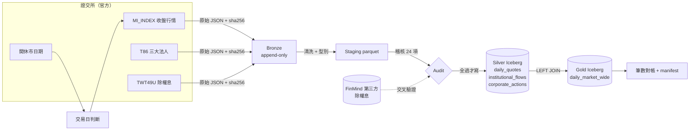
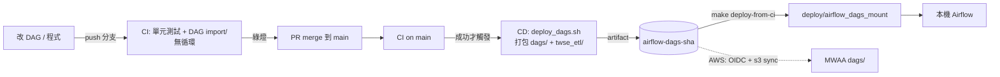

# TWSE Lakehouse ETL

每個交易日收盤後，自動抓證交所「每日收盤行情（MI_INDEX）」與「三大法人買賣超（T86）」，清洗成 parquet，
寫入 Iceberg，產出「每日個股行情＋法人買賣超」合併表，並能回答「上週算訊號時用的是哪一版資料」。

Airflow 3.3（docker-compose, LocalExecutor）· PyIceberg 0.12（SQLite catalog）· Polars · GitHub Actions
· 選配：S3（SeaweedFS）+ Postgres catalog + Trino





---

## 1. 啟動

前置（只裝這兩樣，其餘都在專案資料夾或容器內）：

```bash
brew install colima docker docker-compose && colima start --cpu 4 --memory 8
brew install uv                       # Python 3.12 venv 放在 .venv/
```

```bash
make setup      # .venv（測試、本機跑 pipeline 用）
make up         # 產生 .env（本機隨機 secret）→ 部署 DAG → build image → 起 Airflow
open http://localhost:8080             # 本機用 SimpleAuthManager，不需登入
```

所有狀態都在 `.local/`（Iceberg warehouse、Bronze、log、uv cache），`make clean` 一次清掉；
Airflow metadata DB 在 Colima VM 內的 docker volume。

| 變數（`.env`） | 預設 | 用途 |
|---|---|---|
| `TWSE_SOURCE` | `twse` | `twse` 打真實 API；`fixture` 讀 `fixtures/` 錄好的原始回應（離線 / 被限流時） |
| `ANTHROPIC_API_KEY` | 無 | 啟用「臨時休市」LLM 查證；沒有就一律當異常告警（fail closed） |

## 2. 手動觸發 DAG

```bash
make trigger DATE=2026-10-29     # = airflow dags trigger twse_daily_etl --conf '{"trade_date": "2026-10-29"}'
make status                      # 各次 run 的狀態
```

UI 上按 Trigger 也可以，在 config 填 `trade_date`；留空就是排程當天。
排程：`30 15 * * 1-5`（Asia/Taipei），`catchup=False`、`max_active_runs=1`。

```
check_trading_day ─> wait_for_reports ─> route ─┬─> extract_{quotes,institutional,corporate_actions}
                                                │     ─> stage_* ─> audit ─> publish_silver ─> build_gold ─> reconcile
                                                └─> check_unscheduled_closure
```

| 情況 | 行為 |
|---|---|
| 週末、官方休市日 | `check_trading_day` short-circuit，整個 run 綠燈、下游 skipped |
| 資料晚發布 | sensor 每 10 分鐘看一次（`mode=reschedule` 不佔 worker），17:00 起每次告警 |
| 19:00 仍無資料 | 問 LLM 是否臨時休市：有來源佐證 → 略過並記錄待人工確認；其他一律失敗＋告警 |
| 網路 / TWSE 暫時錯誤 | extract 重試 3 次（指數退避），用盡才告警 |
| 資料本身錯（稽核、對帳、欄位改名） | 不重試，直接失敗＋告警；稽核在寫入前，失敗時 Iceberg 完全沒動 |

告警目前是 `ALERT <event> {json}` 的 log 行（`twse_etl/alerts.py`，換成 Slack/SNS 只改這一個函式）。

## 3. 版本控制示範（Iceberg）

在 Airflow 容器內執行，讀的是 DAG 寫的同一個 catalog：

| | 指令 | 示範什麼 |
|---|---|---|
| 必做 1 | `make demo-snapshots TABLE=daily_quotes` | snapshot 清單：id、時間、operation、run_id、新增/刪除筆數 |
| 必做 2 | `make demo-asof SNAPSHOT=<id>` 或 `make demo-asof AT='2026-10-30 19:29'` | time travel：給 snapshot id 或時間點，查當時內容 |
| 必做 3 | `make demo-correct DATE=2026-10-29` | 模擬證交所修正 2330 成交股數後重抓：無重複、新舊兩版都查得到 |
| 選做 1 | `make demo-rollback TABLE=daily_quotes` | 回到上一次 run 之前的 snapshot |
| 選做 2 | `make demo-evolve TABLE=daily_quotes` | 中途加欄位，舊資料與舊 snapshot 照樣可查 |

`demo-correct` 實際輸出（節錄）：

```
simulated TWSE correction: 2026-10-29 2330 成交股數 18,403,916 -> 12,345,678
  daily_quotes         new snapshot 1729039165247099125
  institutional_flows  skipped (identical source)      <- 來源 bytes 沒變就不產生 snapshot
  corporate_actions    skipped (identical source)
  daily_market_wide    new snapshot 1902940312798802552
rows for 2026-10-29: 1388, distinct stock_id: 1388  (no duplicates)
before snapshot 4941770685423036353: volume_shares=18,403,916
after  snapshot 1729039165247099125: volume_shares=12,345,678
```

一次「覆寫某一天」在 PyIceberg 是 **delete + append 兩個 snapshot、同一個 metadata commit**，
所以讀 current table 的人永遠看不到半套資料；snapshot 清單裡兩筆都帶同一個 run_id。

### 用 SQL 查：big-data 配置（S3 + Postgres catalog + Trino）

預設配置（SQLite catalog + 本機檔案）只能用 Python 讀。要讓策略團隊下 SQL，或資料量變大時：

```bash
make bigdata-up      # 疊加 docker-compose.bigdata.yaml：SeaweedFS（S3 API）+ Postgres（Iceberg JDBC catalog）+ Trino :8081
make trigger DATE=2026-10-29
make trino-sql SQL='SELECT trade_date, count(*) FROM iceberg.twse.daily_market_wide GROUP BY 1'
make trino-sql SQL='SELECT snapshot_id, operation, summary FROM iceberg.twse."daily_quotes$snapshots"'
make trino-sql SQL='SELECT count(*) FROM iceberg.twse.daily_quotes FOR VERSION AS OF <snapshot_id>'
make bigdata-down
```

- pipeline 程式沒有分支：只有 `ICEBERG_CATALOG_URI`、`ICEBERG_WAREHOUSE=s3://warehouse`、`PYICEBERG_CATALOG__TWSE__S3__*`
  這些環境變數不同。PyIceberg 寫、Trino 讀同一個 catalog、同一個 bucket；`make demo-*` 也照用。
- 實測（2026-10-30）：live 跑 10-28、10-29 後，Trino 查 Gold 得 1,386 / 1,388 筆；`$snapshots` 兩個 append；
  `FOR VERSION AS OF` 10-28 的 snapshot 回 1,386 筆，目前版本 2,774 筆。
- 這套的資料在 `.local/object-store/`，和預設配置的 `.local/lake/` 是分開的兩個資料湖。
  Bronze / staging 仍寫本機（`TWSE_DATA_URI`），上雲時同樣改成 `s3://`。
- 本機 S3 的 key `local-dev` 只在這幾個容器之間有效（object store 不對外開 port），不是真的憑證。
- UI：DBeaver（免費桌面版，內建 Trino driver）連 `localhost:8081`，使用者名稱隨意、免密碼，可下 SQL、瀏覽、匯出 CSV / Excel。
  要給團隊用網頁時再加 Superset 或 Metabase 一個服務。量再大時 Trino 加 worker；Spark 也能接同一個 JDBC catalog。

## 4. 測試

```bash
make test       # 27 個：清洗、交易日、稽核、端到端（錄好的真實 TWSE 回應，不連網，約 2 秒）
make dag-test   # 在正式 Airflow image 內：DagBag 無 import error、無循環、task 順序符合規格
make lint
```

CI（`.github/workflows/ci.yml`）每次 push 跑這兩個 job；CD（`cd.yml`）只在 main 上 CI 成功後觸發。

**CI / CD 證據**：見下方 [第 9 節](#9-cicd-證據)。

## 5. 設計決策

### DAG
- **task 切法**：一個 task 做一件可以單獨重跑的事，task 之間只傳小東西（URI、snapshot id）。
  `publish_silver` 刻意一個 task 寫三張表，因為 SQLite catalog 同時只能有一個 writer。
- **交易日三道關**：cron 只排週一到五 → 官方開休市表 → 資料等待＋LLM 查證。
  第三道是因為颱風假永遠不會出現在官方表上（見第 6 節）。
- **重試只給會好的錯**：網路錯誤重試；資料錯誤（稽核失敗、欄位改名）重試也不會變好，直接失敗告警。

### Iceberg 而不是只放 parquet
- parquet 資料夾回答不了「上週二早上這張表長什麼樣」；Iceberg 每次寫入是一個 snapshot，可以 time travel、rollback。
- 覆寫一天是原子的；直接覆蓋 parquet 檔，讀到一半的人會看到半套。
- 欄位演進（加欄位）不用重寫舊檔。
- **Partition**：`identity(trade_date)`。查詢幾乎都按日期篩；一天一個分區讓「修正某一天」只動那一天。
  一天約 1,400 列，小檔問題在這規模不痛；量大時改 `month(trade_date)` + 定期 compaction。
- **不重複＋保留修正前後**：寫入一律 `overwrite(overwrite_filter=trade_date == D)`；
  同一天重跑只會取代那天，舊內容留在前一個 snapshot。來源 sha256 與上次相同時直接跳過，重跑不產生雜訊 snapshot。

### 部署
- **CI** 檢查：清洗與稽核邏輯的單元/端到端測試；在正式 image 內 DagBag import ＋ 無循環。
- **CD**：`scripts/deploy_dags.sh` 把 `dags/` 和 `twse_etl/` 套件打包同步到 Airflow 掛載的資料夾；
  image 只裝第三方套件，改程式不必重 build image。腳本拒絕部署空的 `dags/`（防異常情境 3），每版留 tarball 可一鍵回滾。
- **搬到 AWS（S3 + Glue）要改什麼**：

| 改 | 不改 |
|---|---|
| `ICEBERG_CATALOG_TYPE=glue`、`ICEBERG_WAREHOUSE=s3://…`、`TWSE_DATA_URI=s3://…`（環境變數） | 所有清洗、稽核、Iceberg 讀寫、DAG 程式碼 |
| `docker/requirements.txt` 加 `pyiceberg[glue,s3fs]` | `storage.py` 用 pyarrow FileSystem，本機路徑與 `s3://` 同一套呼叫 |
| CD 開啟 `deploy-aws` job（repo variables：`DEPLOY_TARGET=aws`、`AWS_DEPLOY_ROLE_ARN`、`MWAA_BUCKET`），用 GitHub OIDC，repo 內不放任何金鑰 | 部署腳本本身 |
| 告警函式改送 SNS/Slack | 告警的呼叫點 |

## 6. 資料品質把關（全部在寫入前跑）

| 類別 | 檢查 | 擋不擋 |
|---|---|---|
| 筆數 | 行情 ≥ 900、法人 ≥ 500（正常日約 1,390 / 1,340） | 擋 |
| 主鍵 | (trade_date, stock_id) 唯一、非空；日期等於要求的那天 | 擋 |
| 行情 | low ≤ open, close ≤ high；有收盤價就必須有成交量；漲跌符號 ∈ {+,-,0,X} 且與漲跌值同號 | 擋 |
| 連續性 | `今日收盤 − 漲跌 = 昨日收盤`（除權息後改用開盤競價基準）。真實資料 ~1,360 檔/日，0 筆不符 | 擋 |
| 法人 | 各法人 買−賣=買賣超；自營商=自行+避險；合計=四者相加 | 擋 |
| 跨表 | 法人表的股票都在行情表；**法人覆蓋率 ≥ 85%**（正常 96–97%） | 擋 |
| 除權息 | TWT49U 事件當天行情必為 X；TWT49U 除權息前收盤 = 我們前一日收盤；與 FinMind 參考價一致 | 告警 |
| 寫入後 | Silver 筆數 = staging 筆數；**Gold 筆數 = 行情筆數**；Gold 有法人資料的列 = 法人筆數 | 擋＋告警 |

Gold 用 **LEFT JOIN**（從行情出發），T86 沒列的股票法人欄位填 0、`institutional_reported=false`。
這兩條「覆蓋率」與「Gold = 行情筆數」正是異常情境 2（合併表 800 檔、行情 1,000 多檔、DAG 全綠）的兩道防線。

每次 run 寫一份 manifest（`.local/lake/data/manifests/trade_date=D/<run_id>.json`）：
用了哪些 snapshot id、各表筆數、每項檢查結果。策略團隊引用資料時引用 snapshot id 即可重現。

### 實作中用真實資料發現、並寫成測試的事

1. **MI_INDEX 漲跌欄的 `X`（不比價）**：除權息、特別股、ETN、槓桿 ETF 等當天，TWSE 印 `0.00`。
   存成 0 會讓策略以為「平盤」，所以存 `null`。每天約 5–30 檔 X，只有部分是除權息，因此「無法解釋的 X」只記錄不告警。
2. **2026-10-23 薔琵颱風休市**：官方開休市表沒有這天，MI_INDEX / T86 回「沒有符合條件的資料」，
   和一般假日一模一樣。只看行事曆會判成「資料延遲」最後失敗；pipeline 在 19:00 cutoff 後由 LLM 查證並略過。
3. **颱風日的除息照樣生效**：TWT49U 仍列出 10-23 除息的 2028、6931，下一個交易日 10-27 的漲跌改以
   「開盤競價基準」為基礎、且不標 X。若只看當天事件，連續性檢查會誤報這兩檔。
   所以除權息事件抓「前一個交易日之後到今天」的區間，Gold 在 10-27 標 `is_ex_event=true`。
4. **開休市表裡也有交易日**：「國曆新年開始交易日」「農曆春節前最後交易日」列在同一張表，整張當休市表會漏跑。
5. **零股成交**：有成交股數但收盤價 `--`（只有零股成交），所以只檢查「有收盤價 ⇒ 有成交量」。

## 7. 臨時休市：LLM 查證（fail closed）

```
19:00 仍無資料 → HOLIDAY_LLM_CMD <date> → {"is_holiday": bool, "reason": str, "evidence_url": str|null}
```

- 預設命令 `python -m twse_etl.holiday_llm`：Claude Sonnet 5.5（effort medium）＋ web search，結構化輸出鎖死 JSON schema。
  命令可換（任何 LLM CLI 只要輸出同一個 JSON），pipeline 只認 schema。
- 只有 `is_holiday=true` **且有 evidence_url** 才當休市：寫 `closures/<date>.json`（`pending_human_confirmation`）並告警請人確認。
- LLM 說沒休市、沒給來源、輸出不合 schema、沒有 API key、逾時 → 一律當資料異常，失敗＋告警。
- LLM 只碰控制面（要不要跑），永遠不碰資料面（不改任何數字）。

## 8. 假設與取捨

- 「全部上市股票」= MI_INDEX `type=ALLBUT0999`（含 ETF、特別股、ETN，不含權證、牛熊證），約 1,390 檔；不含上櫃。
- 價格存 `decimal(12,2)`，股數/金額 `int64`；`pe_ratio` 的 0.00 代表無本益比，存 `null`。
- T86 沒列的股票視為當天三大法人零交易（填 0 並以 `institutional_reported` 區分）。
- 證交所修正資料的時點不固定：本設計是「重抓同一天就產生新版本」；生產環境會加 T+1 早上的自動重抓比對。
- 第三方資料（FinMind）只拿來交叉驗證除權息，不進主資料流；repo 內只放測試日期的 13 筆。
- `fixtures/` 是證交所原始回應的逐位元組錄製（`scripts/record_fixtures.py`），CI 不連網；被限流時 `TWSE_SOURCE=fixture`。
- SQLite catalog 是題目指定、適合單機；多人或多 writer 時換 Postgres（JDBC）或 Glue/REST catalog，程式不改
  （Postgres + S3 已實測，見第 3 節 big-data 配置）。

### 對題目我會做得不一樣的地方
- **先稽核再寫入（Write-Audit-Publish）**，而不是「寫入後筆數檢查」：檢查失敗時 Iceberg 沒有被污染，不用 rollback。
- **交易日判斷不能只靠行事曆**：臨時休市只能從「資料沒來」反推，需要第二個證據來源。
- **連續性檢查比筆數檢查更能抓錯**：筆數對但價格錯（例如欄位錯位）只有跨日勾稽抓得到。
- **staging parquet 定位成「稽核對象」**，不是另一份對外的資料；對外只開放 Iceberg。

## 9. CI/CD 證據

| 流程 | GitHub Actions run | 結果 |
|---|---|---|
| 第一次 push main：CI（`unit-tests` + `dag-integrity`） | [CI](https://github.com/smpss92118/twse-lakehouse-etl/actions/runs/41049725767) | success |
| CI 通過後自動 CD：打包 `airflow-dags-<sha>` artifact；`deploy-aws` 未啟用所以 skipped | [CD](https://github.com/smpss92118/twse-lakehouse-etl/actions/runs/41049857773) | success |
| 變更走 PR：[#1](https://github.com/smpss92118/twse-lakehouse-etl/pull/1) 加 `dagrun_timeout` 與 DAG 層告警 | [CI on PR](https://github.com/smpss92118/twse-lakehouse-etl/actions/runs/41050021409) | success |
| merge 到 main 後：CI → CD（`workflow_run` 觸發） | [CI](https://github.com/smpss92118/twse-lakehouse-etl/actions/runs/41051534893) → [CD](https://github.com/smpss92118/twse-lakehouse-etl/actions/runs/41051666660) | success |

本機套用 CD 產出的那一包：`make deploy-from-ci`（掛載資料夾裡的 `DEPLOYED_VERSION` 會等於 main 的 commit sha）。
GitHub 的雲端 runner 連不到本機 Airflow，所以最後一步是一行指令；上 AWS 時由 `deploy-aws` job 自動完成。

## 10. 目錄

```
dags/twse_daily_etl.py        Airflow DAG（只編排，邏輯都在 twse_etl/）
src/twse_etl/
  config.py                   全部設定來自環境變數（本機 / CI / AWS 只差這裡）
  sources.py                  TWSE endpoints、fixture 重播、Bronze 寫入
  trading_calendar.py         官方開休市表
  transform.py                原始 JSON → 型別正確的 DataFrame（純函式）
  contracts.py                中文欄名→英文欄名、Silver/Gold schema、門檻
  validate.py                 稽核檢查
  corporate_actions.py        除權息三方交叉驗證
  iceberg_io.py               catalog、冪等覆寫一天、讀取
  gold.py                     合併表
  holiday_fallback.py         LLM 查證的契約與 fail-closed 判斷
  holiday_llm.py              預設 LLM CLI（Claude + web search）
  pipeline.py                 各步驟（DAG 一個 task 呼叫一個）＋ CLI
scripts/demo_versioning.py    版本控制示範
scripts/deploy_dags.sh        CD 部署腳本（本機與 CI 共用）
scripts/record_fixtures.py    錄製證交所原始回應
fixtures/                     錄製的原始回應（gzip）＋ FinMind 小樣本
tests/                        pytest
docker/ docker-compose.yaml   Airflow image 與本機環境
docker-compose.bigdata.yaml   選配：S3（SeaweedFS）+ Postgres catalog + Trino（docker/trino、docker/seaweedfs 設定）
```
