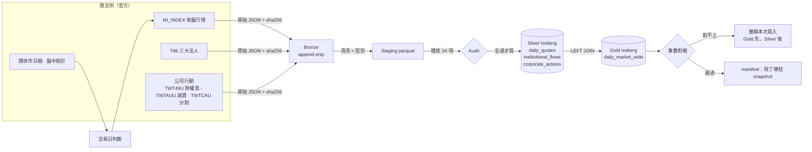
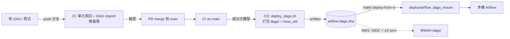

# TWSE Lakehouse ETL

每個交易日收盤後，自動抓證交所「每日收盤行情（MI_INDEX）」與「三大法人買賣超（T86）」，清洗成 parquet，
寫入 Iceberg，產出「每日個股行情＋法人買賣超」合併表，並能回答「上週算訊號時用的是哪一版資料」。

Airflow 3.3（docker-compose, LocalExecutor）· PyIceberg 0.12（SQLite catalog）· Polars · GitHub Actions
· 選配：S3（SeaweedFS）+ Postgres catalog + Trino





---

## 1. 啟動

前置（只裝這兩樣，其餘都在專案資料夾或容器內）：

```bash
brew install colima docker docker-compose && colima start --cpu 4 --memory 8
brew install uv                       # 有 Python 3.12 就用；沒有時 uv 自動下載到 .local/python/
```

```bash
make setup      # .venv（測試、本機跑 pipeline 用）
make up         # 產生 .env（本機隨機 secret）→ 部署 DAG → build image → 起 Airflow
make passwords  # 本機登入帳號 admin，密碼首次啟動時隨機產生（不進 repo）
open http://localhost:8080
```

所有狀態都在 `.local/`（Iceberg warehouse、Bronze、log、uv cache），`make clean` 一次清掉；
Airflow metadata DB 在 Colima VM 內的 docker volume。不需要任何雲端帳號或 API key。

### 開關服務

由外往內開、由內往外關。關閉不會刪資料，下次開起來從原狀繼續。

| 層級 | 開 | 關 |
|---|---|---|
| Docker 虛擬機（Colima，約 8 GB 記憶體） | `colima start --cpu 4 --memory 8` | `colima stop`（先關下面的服務） |
| 預設配置：Airflow + Postgres，SQLite catalog | `make up` | `make down` |
| big-data 配置：上面再加 S3、Iceberg catalog、Trino、SQL 網頁 | `make bigdata-up` | `make bigdata-down` |
| big-data 配置裡的單一服務 | `make start SVC=<服務>` | `make stop SVC=<服務>` |

兩種配置用的是不同的資料湖（第 3 節），同一時間只開一種。`make services` 列出所有服務與目前狀態：

| 服務（`SVC=`） | 網址 | 做什麼 |
|---|---|---|
| `airflow-apiserver` | http://localhost:8080 | Airflow 網頁與 API（`make passwords` 看帳密） |
| `airflow-scheduler` | | 排程、執行 task |
| `airflow-dag-processor` | | 解析 DAG 檔 |
| `postgres` | | Airflow 自己的資料庫 |
| `object-store` | | S3（SeaweedFS），存 Iceberg 資料檔 |
| `iceberg-catalog-db` | | Iceberg catalog（Postgres） |
| `trino` | http://localhost:8081 | SQL 查詢引擎（`make trino-sql`；網頁只能看查詢狀態） |
| `sql-ui` | http://localhost:8978 | SQL 網頁（CloudBeaver，`make sql-ui` 開啟） |

`airflow-init` 每次啟動時做一次資料庫遷移就結束，不用另外開關。開某個服務時，它依賴的服務也會一起開
（例如 `sql-ui` 會帶起 `trino`、`object-store`、`iceberg-catalog-db`）。

`.env` 裡只有一個開關要知道：`TWSE_SOURCE=twse` 打真實 API；`fixture` 讀 `fixtures/` 錄好的原始回應（離線 / 被限流時）。

## 2. 手動觸發 DAG

```bash
make trigger DATE=2026-10-29     # = airflow dags trigger twse_daily_etl --conf '{"trade_date": "2026-10-29"}'
make status                      # 各次 run 的狀態
```

UI 上按 Trigger 也可以，在 config 填 `trade_date`；留空就是排程當天。
排程：`30 15 * * 1-5`（Asia/Taipei），`catchup=False`、`max_active_runs=1`。
第一次 `make up`（metadata DB 還是空的）建出來的 DAG 是暫停的（`DAGS_ARE_PAUSED_AT_CREATION`），
`make trigger` 會順便打開，之後重啟都維持打開；
要讓 15:30 的排程自己跑，在 UI 打開開關或先跑一次 `make trigger`。

```
check_trading_day ─> wait_for_reports ─> route ─┬─> extract_{quotes,institutional,corporate_actions}
                                                │     ─> stage_* ─> audit ─> publish_silver ─> build_gold ─> reconcile
                                                └─> check_unscheduled_closure
```

| 情況 | 行為 |
|---|---|
| 週末、官方休市日 | `check_trading_day` short-circuit，整個 run 綠燈、下游 skipped |
| 資料晚發布 | sensor 每 10 分鐘看一次（`mode=reschedule` 不佔 worker），17:00 起每次告警 |
| 19:00 兩份都沒資料 | 問證交所盤中統計（MI_5MINS）：明確「沒有資料」→ 臨時休市，記錄證據後略過（綠燈）；其他一律失敗＋告警（第 7 節） |
| 19:00 只出了一份（例如行情有、法人沒有） | 市場有開，只是晚了：直接失敗＋告警，資料到了再重跑 |
| 前一個交易日沒載入 | 稽核擋下並指名要先補哪一天，不會誤報成「價格不連續」 |
| 網路 / TWSE 暫時錯誤 | 交易日判斷、擷取重試 3 次（指數退避）；等待中的 sensor 把它當「還沒好」，到 19:00 才算失敗 |
| 稽核失敗、行情或法人表欄位改名（寫入前） | 不重試，直接失敗＋告警；Iceberg 完全沒動 |
| 公司行動表改了欄位、某列算不出因子 | 那張表／那列丟掉並告警，行情和法人照常入庫；只有颱風順延、不標 X 的除權息會讓連續性檢查擋下，訊息會指出原因 |
| 對帳失敗（寫入後） | 自動撤銷本次 run 在每張表的寫入（Gold 先），再失敗＋告警；讀的人停在上一個正確版本 |

告警目前是 `ALERT <event> {json}` 的 log 行（`twse_etl/alerts.py`，換成 Slack/SNS 只改這一個函式）。

## 3. 版本控制示範（Iceberg）

在 Airflow 容器內執行，讀的是 DAG 寫的同一個 catalog（`.local/lake`）。示範前先把資料跑進去：

```bash
make up                          # 也會把最新程式部署進容器
make trigger DATE=2026-10-28     # 等綠燈再跑下一天：連續性檢查要讀前一個交易日
make trigger DATE=2026-10-29
```

`demo-correct` 需要那一天的 Bronze，所以那天必須用 DAG 跑過。同一個 `VOLUME` 只能示範一次：第二次最新的
Bronze 已經是修正版，四張表都會 `skipped (identical content)`；重做時換 `VOLUME=`。

| | 指令 | 示範什麼 |
|---|---|---|
| 必做 1 | `make demo-snapshots TABLE=daily_quotes` | snapshot 清單：id、時間、operation、run_id、新增/刪除筆數 |
| 必做 2 | `make demo-asof SNAPSHOT=<id>` 或 `make demo-asof AT='2026-10-30 19:29'` | time travel：給 snapshot id 或時間點，查當時內容 |
| 必做 3 | `make demo-correct DATE=2026-10-29` | 模擬證交所修正 2330 成交股數後重抓：無重複、新舊兩版都查得到 |
| 選做 1 | `make demo-rollback` | 退回最近一次 run 之前：該 run 寫過的每張表一起退（`TABLE=…` 只退一張） |
| 選做 2 | `make demo-evolve TABLE=daily_quotes` | 中途加欄位，舊資料與舊 snapshot 照樣可查 |
| 加做 | `make demo-adjusted`（= `STOCK=2762 START=2026-10-28 END=2026-10-29`） | 還原權值（前復權；`METHOD=forward` 後復權），查詢時計算、不改歷史（第 6 節） |

`demo-correct` 實際輸出（節錄）：

```
simulated TWSE correction: 2026-10-29 2330 成交股數 18,403,916 -> 12,345,678
  daily_quotes         new snapshot 1729039165247099125
  institutional_flows  skipped (identical content)     <- 內容沒變就不產生 snapshot
  corporate_actions    skipped (identical content)
  daily_market_wide    new snapshot 1902940312798802552
rows for 2026-10-29: 1388, distinct stock_id: 1388  (no duplicates)
before snapshot 4941770685423036353: volume_shares=18,403,916
after  snapshot 1729039165247099125: volume_shares=12,345,678
```

一次「覆寫某一天」在 PyIceberg 是 **delete + append 兩個 snapshot、同一個 metadata commit**，
所以讀 current table 的人永遠看不到半套資料；snapshot 清單裡兩筆都帶同一個 run_id。

### 用 SQL 查：big-data 配置（S3 + Postgres catalog + Trino）

預設配置（SQLite catalog + 本機檔案）只能用 Python 讀。要讓策略團隊下 SQL：

```bash
make bigdata-up      # 疊加 docker-compose.bigdata.yaml：SeaweedFS（S3 API）+ Postgres（Iceberg JDBC catalog）+ Trino :8081 + SQL 網頁 :8978
make trigger DATE=2026-10-29
make trino-sql SQL='SELECT trade_date, count(*) FROM iceberg.twse.daily_market_wide GROUP BY 1'
make trino-sql SQL='SELECT snapshot_id, operation, summary FROM iceberg.twse."daily_quotes$snapshots"'
make trino-sql SQL='SELECT count(*) FROM iceberg.twse.daily_quotes FOR VERSION AS OF <snapshot_id>'
make bigdata-down
```

- pipeline 程式沒有分支：只有 `ICEBERG_CATALOG_URI`、`ICEBERG_WAREHOUSE=s3://warehouse`、`PYICEBERG_CATALOG__TWSE__S3__*`
  這些環境變數不同。PyIceberg 寫、Trino 讀同一個 catalog、同一個 bucket；`make demo-*` 也照用。
- 實測（2026-10-30）：live 跑 10-28、10-29 後，Trino 查 Gold 得 1,386 / 1,388 筆；`FOR VERSION AS OF` 10-28 的
  snapshot 回 1,386 筆，目前版本 2,774 筆。
- 資料在 `.local/object-store/`，和預設配置的 `.local/lake/` 是兩個資料湖。本機 S3 的 key `local-dev`
  只在這幾個容器之間有效（object store 不對外開 port），不是真的憑證。
- **網頁 UI**：`make sql-ui` 開 http://localhost:8978（CloudBeaver）。連線已預先設好、免登入、唯讀，
  左側 `TWSE Iceberg (Trino)` → `iceberg` → `twse` 點表就能看資料、下 SQL、匯出 CSV / Excel。
  桌面版 DBeaver 也可以：新增 Trino 連線 `localhost:8081`，使用者名稱隨意、免密碼。

## 4. 測試

```bash
make test       # 74 個，不連網，約 4 秒
make dag-test   # 在正式 Airflow image 內：DagBag 無 import error、無循環、task 順序符合規格
make lint
```

測試資料是 `fixtures/` 裡錄好的真實 TWSE 回應，再加上刻意弄壞的版本：

| 測什麼 | 怎麼測 |
|---|---|
| 每一項阻擋檢查都真的會擋 | 真實的 10-29 先全過；再逐一注入 25 種壞資料（重複列、high 比 close 低、空值、符號錯、法人加總錯、800 筆半套…），每種都要讓對應的檢查失敗 |
| 等待閘門 | 空回應、TWSE 還在回前一天、上傳到一半（500 筆）都不能當成「資料到了」 |
| 臨時休市 | 颱風日證交所盤中統計明確沒資料 → 略過並留證據；有盤中成交、或沒有明確回答 → 必須失敗；行情已出但法人沒出 → 不判休市 |
| 冪等與修正 | 重跑不產生 snapshot；修正某天後無重複、舊版可查；修好 parser 後重跑會寫新版 |
| 對帳失敗（異常情境 2） | 合併表少了列 → 每張表撤銷回上一版（首次載入則刪掉這次寫的），修好後重跑正常 |
| 還原權值 | 94 筆真實除權息「前收 − 權值+息值 = 參考價（捨去到分）」全部成立，差 0.01 也抓得到；0050 分割日的連續性與還原後報酬 |
| 端到端 | 10-22 到 10-29 回填：颱風日、週末、補假、颱風日的除息在 10-27 生效、減資恢復交易 |

CI（`.github/workflows/ci.yml`）每次 push 跑這兩個 job；CD（`cd.yml`）只在 main 上 CI 成功後觸發（證據見第 9 節）。

## 5. 設計決策

### DAG
- **task 切法**：一個 task 做一件可以單獨重跑的事，task 之間只傳小東西（URI、snapshot id）。
  `publish_silver` 刻意一個 task 寫三張表，因為 SQLite catalog 同時只能有一個 writer。
- **交易日三道關**：cron 只排週一到五 → 官方開休市表 → 資料等待＋證交所盤中統計。
  第三道是因為颱風假永遠不會出現在官方表上（第 7 節）。
- **重試只給會好的錯**：網路錯誤重試；資料錯誤（稽核失敗、欄位改名）重試也不會變好，直接失敗告警。

### Iceberg 而不是只放 parquet
- parquet 資料夾回答不了「上週二早上這張表長什麼樣」；Iceberg 每次寫入是一個 snapshot，可以 time travel、rollback。
- 覆寫一天是原子的；直接覆蓋 parquet 檔，讀到一半的人會看到半套。
- 欄位演進不用重寫舊檔：程式裡的 schema 多了欄位，部署後第一次寫入就自動 `union_by_name` 加上，舊資料讀成 null。
- **不重複＋保留修正前後**：寫入一律 `overwrite(overwrite_filter=trade_date == D)`；同一天重跑只會取代那天，
  舊內容留在前一個 snapshot。
- **冪等看內容，不看來源 bytes**：寫入前算「內容指紋」（排除 run_id、寫入時間等每次都不同的欄位後的 sha256），
  與目前版本相同才跳過，所以重跑不產生雜訊 snapshot；修好 parser 後重跑，TWSE bytes 沒變但內容變了，照樣寫新版。

### Partition：現在按日，回補多年歷史後改按年＋compaction

現在是 `identity(trade_date)`：修正一天＝原子地換掉那一天的檔案，snapshot 上的增刪筆數一目了然（刪 1,388、加 1,388）。
代價是小檔：每張表一天只有約 72 KB。用 `scripts/bench_partitions.py` 量 500 個交易日（每天 1,390 檔、照 pipeline
的寫法每天一次 overwrite，本機 SSD）：

| | 按日（現在） | 按年，不 compaction | 按年＋compaction |
|---|---|---|---|
| 檔案數 / manifest 數 | 500 / 500 | 500 / 500 | 2 / 1 |
| 每次寫入延遲（前 10 天平均 → 最後 10 天平均） | 20 → 322 ms | 22 → 449 ms | — |
| 讀全部（回測） | 531 ms | 528 ms | **10 ms** |
| 單一股票全歷史 | 581 ms | 659 ms | **11 ms** |
| 單日 | 9.5 ms | **150 ms** | 9.6 ms |
| 最近 60 天 | 86 ms | 189 ms | 10 ms |

- **檔案數由寫入次數決定，不是分區粒度。** 只改成按年分區、不 compaction，檔案一樣多，單日查詢反而變慢。
- **效益來自 compaction**；按年分區的作用是讓 compaction 能把一年合成一個檔（compaction 不跨分區）。
- 兩種寫法的寫入延遲都隨 commit 數上升（每天多一個 manifest），所以 manifest 合併與 snapshot 過期本來就該排程。

所以等歷史回補到多年時：partition evolution 改 `year(trade_date)`（只改 metadata，舊檔不重寫，新舊 layout 共存），
加上每週 compaction（Trino `ALTER TABLE … EXECUTE optimize`；PyIceberg 0.12 還沒有 compaction）與 snapshot 過期。
被訊號引用過的 snapshot 先打 Iceberg tag 再過期，才不會失去「當時用的是哪一版」。

### 部署
- **CI** 檢查：清洗與稽核邏輯的單元/端到端測試；在正式 image 內 DagBag import ＋ 無循環。
- **CD**：`scripts/deploy_dags.sh` 把 `dags/` 和 `twse_etl/` 套件打包同步到 Airflow 掛載的資料夾；
  image 只裝第三方套件，改程式不必重 build image。腳本拒絕部署空的 `dags/`（防異常情境 3），每版留 tarball 可一鍵回滾。
- **搬到 AWS（S3 + Glue）要改什麼**：

| 改 | 不改 |
|---|---|
| 環境變數：`ICEBERG_CATALOG_TYPE=glue`、`ICEBERG_WAREHOUSE=s3://…`、`TWSE_DATA_URI=s3://…` | 清洗、稽核、對帳與撤銷、還原權值、Iceberg 讀寫、DAG 的程式碼 |
| `docker/requirements.txt` 加 `pyiceberg[glue,s3fs]`；MWAA 的執行角色給 S3 + Glue 權限（不放金鑰） | `storage.py`：pyarrow FileSystem，本機路徑與 `s3://` 同一套呼叫 |
| CD 開啟 `deploy-aws` job（repo variables：`DEPLOY_TARGET=aws`、`AWS_DEPLOY_ROLE_ARN`、`MWAA_BUCKET`），GitHub OIDC | 部署腳本本身（`aws s3 sync` 同一包） |
| `alerts.py` 改送 SNS / Slack | 告警的呼叫點 |
| 登入：SimpleAuthManager → MWAA 的 IAM / SSO | DAG 與權限以外的一切 |
| SQL：Trino → Athena（同一個 Glue catalog，SQL 幾乎不用改） | Iceberg 表、snapshot、time travel 查法 |

Bronze / staging 寫 `s3://` 在設計上支援，但目前只有 Iceberg warehouse 在 S3（SeaweedFS）實測過。

## 6. 資料品質把關（寫入前稽核 24 項，寫入後對帳 4 項）

| 類別 | 檢查 | 擋不擋 |
|---|---|---|
| 前一交易日 | 依行事曆與已記錄的休市，前一個交易日必須已載入；缺了就要求先補，不拿更早的收盤來比 | 擋 |
| 筆數 | 行情 ≥ 900、法人 ≥ 500（正常日約 1,390 / 1,340） | 擋 |
| 主鍵 | (trade_date, stock_id) 唯一、非空；日期等於要求的那天 | 擋 |
| 行情 | low ≤ open, close ≤ high；有收盤價就必須有成交量；漲跌符號 ∈ {+,-,0,X} 且與漲跌值同號 | 擋 |
| 連續性 | `今日收盤 − 漲跌 = 昨日收盤`；有除權息、減資、分割時改用開盤競價基準。真實資料 ~1,360 檔/日，0 筆不符 | 擋 |
| 法人 | 各法人 買−賣=買賣超；自營商=自行+避險；合計=四者相加 | 擋 |
| 跨表 | 法人表的股票都在行情表；**法人覆蓋率 ≥ 85%**（正常 96–97%） | 擋 |
| 公司行動 | 調整因子在合理範圍：除權息 (0, 1]，減資／分割 (0, 100] | 擋 |
| 公司行動 | 同一列 `前收 − 權值+息值 = 參考價`（捨去到分）；事件前收 = 我們自己的前一日收盤 | 告警 |
| 寫入後 | Silver 筆數 = staging 筆數；**Gold 筆數 = 行情筆數**；Gold 有法人資料的列 = 法人筆數 | 撤銷本次寫入＋失敗告警 |

24 項 = 22 項擋 + 2 項只告警。只告警的 2 項比對的是公司行動這個「加值欄位」：對不上時照證交所公布值入庫並告警，
不讓它擋住策略團隊明天要用的 1,390 檔行情與法人資料。公司行動表本身壞掉也一樣不擋：欄位改名就丟掉那張表、
某列沒有前收或參考價就丟掉那一列，都發告警（`corporate_actions_unavailable`、`corporate_action_dropped`），原始頁面留在 Bronze，
修好解析後重跑就補上。唯一的例外是颱風順延、不標 X 的除權息：少了事件，連續性檢查會擋下那一天，失敗訊息會指出原因。

Gold 用 **LEFT JOIN**（從行情出發），T86 沒列的股票法人欄位填 0、`institutional_reported=false`。
異常情境 2（合併表 800 檔、行情 1,000 多檔、DAG 全綠）有三道防線：寫入前的「法人覆蓋率」、寫入後的「Gold = 行情筆數」，
以及對帳失敗時**自動撤銷**：每張表退回這次 run 之前的 snapshot（若是第一次載入就刪掉這次寫的列），
讀的人永遠不會看到少了列的合併表。撤銷紀錄寫在 manifest 的 `undone`。

每次 run 寫一份 manifest（`.local/lake/data/manifests/trade_date=D/<run_id>.json`）：
用了哪些 snapshot id、各表筆數、每項檢查結果。策略團隊引用資料時引用 snapshot id 即可重現。

### 實作中用真實資料發現、並寫成測試的事

1. **MI_INDEX 漲跌欄的 `X`（不比價）**：除權息、特別股、ETN、槓桿 ETF 等當天，TWSE 印 `0.00`。
   存成 0 會讓策略以為「平盤」，所以存 `null`。
2. **2026-10-23 薔琵颱風休市**：官方開休市表沒有這天，MI_INDEX / T86 回「沒有符合條件的資料」，
   和一般假日一模一樣。只看行事曆會判成「資料延遲」最後失敗（第 7 節）。
3. **颱風日的除息照樣生效**：TWT49U 仍列出 10-23 除息的 2028、6931，下一個交易日 10-27 的漲跌改以
   「開盤競價基準」為基礎、且不標 X。若只看當天事件，連續性檢查會誤報這兩檔。
   所以除權息事件抓「前一個交易日之後到今天」的區間，Gold 在 10-27 標 `is_ex_event=true`。
4. **開休市表裡也有交易日**：「國曆新年開始交易日」「農曆春節前最後交易日」列在同一張表，整張當休市表會漏跑。
5. **零股成交**：有成交股數但收盤價 `--`（只有零股成交），所以只檢查「有收盤價 ⇒ 有成交量」。
6. **ETF 分割日不標 X**：0050 在 2025-06-18 以 1 拆 4 恢復交易，漲跌 +0.41 是相對參考價 47.16，不是前收 188.65。
   沒有分割事件的話，未調整的序列會顯示 −74.8%。

### 還原權值：存原始價＋每日因子，查詢時才算

**原則：不改寫歷史。** Gold 存 TWSE 印出的價格，加上當天生效事件的 `adj_factor = 參考價 / 事件前收盤`。
若在除權息日把幾年的收盤全部改寫，每個舊 snapshot 都會和今天對不上，「上週的訊號用的是哪版資料」就答不出來。
前復權、後復權都是查詢時對因子做累乘：

```bash
make demo-adjusted STOCK=2028 START=2026-10-22 END=2026-10-29              # 前復權（預設，最後一天保持原價）
make trino-sql SQL="SELECT trade_date, close, adj_factor,
  round(close * coalesce(exp(sum(ln(adj_factor)) OVER (PARTITION BY stock_id ORDER BY trade_date DESC
    ROWS BETWEEN UNBOUNDED PRECEDING AND 1 PRECEDING)), 1), 4) AS close_adj
  FROM iceberg.twse.daily_market_wide WHERE stock_id = '2762' ORDER BY trade_date"
```

實測（live，2762 於 10-29 除息）：10-28 收盤 80.00 × 0.977375 = **78.19 = 官方除息參考價**，Python 與 Trino 結果相同。
回測要避免前視時用後復權（`METHOD=forward`）：第一天保持原價，之後的價格不會因為未來的除權息而改變。

**事件來源**：TWT49U（除權息）、TWTAUU（減資恢復買賣）、TWTCAU（ETF 分割／反分割），直接採用證交所公布的參考價。
參考價是證交所定義的、市場就照它交易，所以要驗的不是「證交所算得對不對」，而是「我們讀對沒有」：

1. 非 X 日：`收盤 − 漲跌 = 開盤競價基準`（0050：47.57 − 0.41 = 47.16），交易所自己的價格序列確認了事件（擋）。
2. TWT49U 同一列：`前收 − 權值+息值` 捨去到分 = 參考價。同列三個欄位對得上，就代表沒有讀錯欄（告警）。
   錄到的 94 筆除權息全部成立（包括現金增資）；參考價差 0.01 也會被抓到。
3. 事件前收 = 我們自己 Silver 的前一日收盤：兩份報表、同一個數字（告警）。

## 7. 臨時休市：用證交所自己的盤中統計判斷

```
19:00 cutoff 仍無資料
 ├─ 行情或法人任一份已有資料 → 市場有開、只是晚 → 失敗＋告警
 └─ 兩份都是 0 筆 → 抓 MI_5MINS（每 5 秒委託成交統計，開盤日 09:00–13:30 都有紀錄）
      ├─ 證交所明確回「沒有符合條件的資料」→ 臨時休市：寫 closures/<date>.json（附 Bronze 裡的原始回應），run 綠燈
      └─ 有盤中紀錄，或任何其他回應 → 失敗＋告警（fail closed）
```

- 實測：2026-10-22（正常日）3,241 筆；10-23 與 2024-10-31（颱風）都是「沒有符合條件的資料」。
- 為什麼等到 cutoff 才問、而且要兩份報表都沒資料：如果單一來源暫時異常回「沒資料」，就會把交易日判成休市、
  靜默略過。要求兩個獨立條件同時成立，誤判的方向只會是「多告警一次」，不會是「少一天資料」。
- 不用行事曆以外的公告或新聞：人事行政總處公布的是「台北市停班」，不等於「證交所休市」；
  問交易所「那天有沒有成交」最直接，結果確定、免金鑰，用的也是同一個資料源。
- fixture 模式下，沒錄到 MI_5MINS 的日子一律當異常（不會因為「找不到檔案」被判成休市）。
- 19:00 前不判斷：開盤前 MI_5MINS 本來就是空的。CLI 在 cutoff 前跑到沒資料的日子會回 `IncompleteDataError`，
  DAG 則由 sensor 等到 cutoff 才走這條路。
- 人工補記（例如事後確認）：`python -m twse_etl.pipeline record-closure --date 2026-10-23 --reason "颱風"`。
  記錄過的休市日，下一個交易日的「前一交易日已載入」檢查才會跳過它。

## 8. 假設與取捨

- 「全部上市股票」= MI_INDEX `type=ALLBUT0999`（含 ETF、特別股、ETN，不含權證、牛熊證），約 1,390 檔；不含上櫃。
- 價格存 `decimal(12,2)`，股數/金額 `int64`；`pe_ratio` 的 0.00 代表無本益比，存 `null`。
  decimal 讓「收盤 − 漲跌 = 昨收」這類檢查能精確相等；拿去做研究時再轉 float。
- T86 沒列的股票視為當天三大法人零交易（填 0 並以 `institutional_reported` 區分）。
- 證交所修正資料的時點不固定：本設計是「重抓同一天就產生新版本」；生產環境會加 T+1 早上的自動重抓比對。
- 公司行動在題目範圍外，加進來是因為兩件事需要它：連續性檢查遇到除權息日需要參考價，
  以及策略團隊算報酬時需要調整因子。只用證交所公布值，不另外抓明細頁重算、不接第三方資料。
- **還原權值的缺口**：面額變更（例如 10 元改 1 元）在 TWSE 網站上找不到 JSON endpoint，目前沒有調整因子。
- `fixtures/` 是證交所原始回應的逐位元組錄製（`scripts/record_fixtures.py`），CI 不連網；被限流時 `TWSE_SOURCE=fixture`。
- SQLite catalog 是題目指定、適合單機；多人或多 writer 時換 Postgres（JDBC）或 Glue/REST catalog，程式不改
  （Postgres + S3 已實測，見第 3 節 big-data 配置）。

### 對題目我會做得不一樣的地方
- **先稽核再寫入（Write-Audit-Publish）**，而不是「寫入後筆數檢查」：檢查失敗時 Iceberg 沒有被污染。
- **寫入後的筆數檢查失敗要自動撤銷**，不能只告警：DAG 紅燈時，讀的人不該已經拿到壞的合併表。
- **交易日判斷不能只靠行事曆**：臨時休市只能從「資料沒來」反推，需要第二個證據來源（交易所自己的盤中統計）。
- **連續性檢查比筆數檢查更能抓錯**：筆數對但價格錯（例如欄位錯位）只有跨日勾稽抓得到。
- **staging parquet 定位成「稽核對象」**，不是另一份對外的資料；對外只開放 Iceberg。

## 9. CI/CD 證據

| 流程 | GitHub Actions run | 結果 |
|---|---|---|
| 變更走 PR：[#2](https://github.com/smpss92118/twse-lakehouse-etl/pull/2) S3 + Postgres catalog + Trino 配置 | [CI on PR](https://github.com/smpss92118/twse-lakehouse-etl/actions/runs/41055269301)（`unit-tests` + `dag-integrity`） | success |
| merge 到 main 後：CI → CD（`workflow_run` 觸發，打包 `airflow-dags-<sha>` artifact；`deploy-aws` 未啟用所以 skipped） | [CI](https://github.com/smpss92118/twse-lakehouse-etl/actions/runs/41057397362) → [CD](https://github.com/smpss92118/twse-lakehouse-etl/actions/runs/41057539182) | success |
| [#5](https://github.com/smpss92118/twse-lakehouse-etl/pull/5) 收斂到題目範圍（改 DAG）→ merge → main 的 CI → CD | [CI on PR](https://github.com/smpss92118/twse-lakehouse-etl/actions/runs/41304303953) → [CI](https://github.com/smpss92118/twse-lakehouse-etl/actions/runs/41304530835) → [CD](https://github.com/smpss92118/twse-lakehouse-etl/actions/runs/41304617177) | success |
| [#6](https://github.com/smpss92118/twse-lakehouse-etl/pull/6) 公司行動降級、CLI 也擋 19:00、首批 TWSE 呼叫重試（改 DAG）→ merge → main 的 CI → CD | [CI on PR](https://github.com/smpss92118/twse-lakehouse-etl/actions/runs/41310948376) → [CI](https://github.com/smpss92118/twse-lakehouse-etl/actions/runs/41311133145) → [CD](https://github.com/smpss92118/twse-lakehouse-etl/actions/runs/41311221857) | success |

CD 的觸發條件：上游 CI 必須是**本 repo** `main` 的 **push** 且成功（或手動 `workflow_dispatch`）。
fork 的 PR、或任何分支名叫 main 的外部分支，都不會觸發部署。

本機套用 CD 產出的那一包：`make deploy-from-ci`（掛載資料夾裡的 `DEPLOYED_VERSION` 會等於 main 的 commit sha）。
GitHub 的雲端 runner 連不到本機 Airflow，所以最後一步是一行指令；上 AWS 時由 `deploy-aws` job 自動完成。

## 10. 目錄

```
dags/twse_daily_etl.py        Airflow DAG（只編排，邏輯都在 twse_etl/）
src/twse_etl/
  config.py                   全部設定來自環境變數（本機 / CI / AWS 只差這裡）
  sources.py                  TWSE endpoints、fixture 重播、Bronze 寫入
  trading_calendar.py         官方開休市表
  transform.py                原始 JSON → 型別正確的 DataFrame（純函式）
  contracts.py                中文欄名→英文欄名、Silver/Gold schema、門檻
  validate.py                 稽核檢查
  corporate_actions.py        公司行動：調整因子的讀取檢查
  adjust.py                   還原權值（前復權／後復權），查詢時計算
  iceberg_io.py               catalog、冪等覆寫一天、撤銷一次 run、讀取
  gold.py                     合併表
  pipeline.py                 各步驟（DAG 一個 task 呼叫一個）、臨時休市判斷、CLI
scripts/demo_versioning.py    版本控制示範
scripts/deploy_dags.sh        CD 部署腳本（本機與 CI 共用）
scripts/record_fixtures.py    錄製證交所原始回應
scripts/bench_partitions.py   按日 vs 按年分區的實測（第 5 節）
fixtures/                     錄製的原始回應（gzip）
tests/                        pytest
docker/ docker-compose.yaml   Airflow image 與本機環境
docker-compose.bigdata.yaml   選配：S3（SeaweedFS）+ Postgres catalog + Trino + SQL 網頁
```
